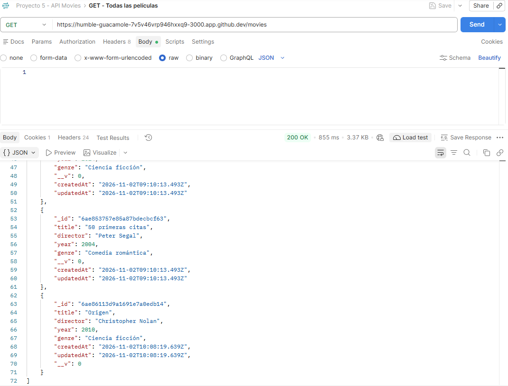
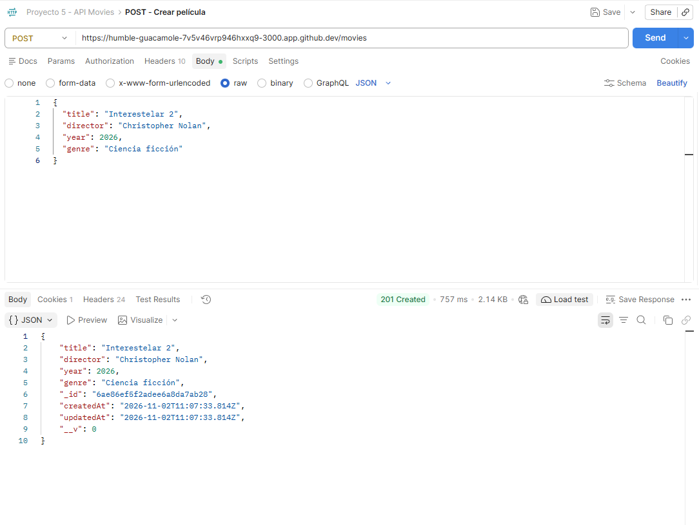
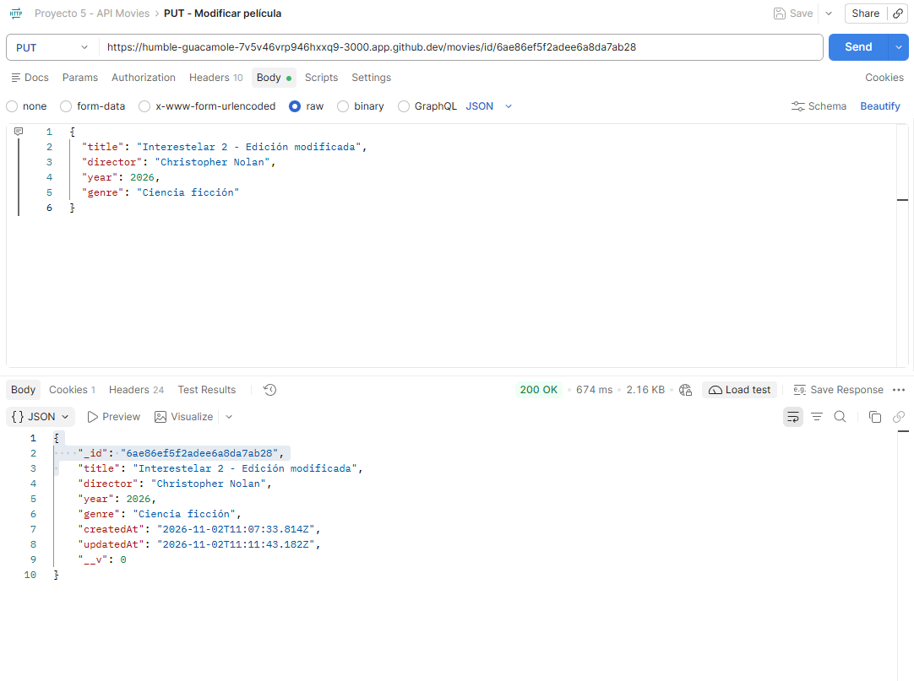
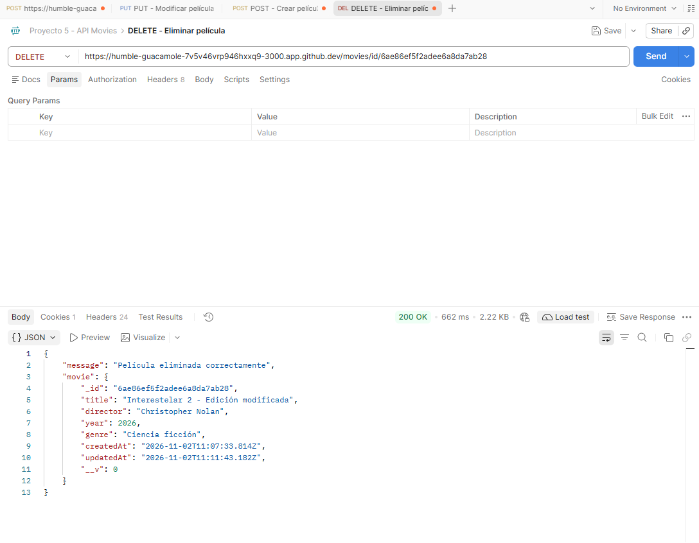
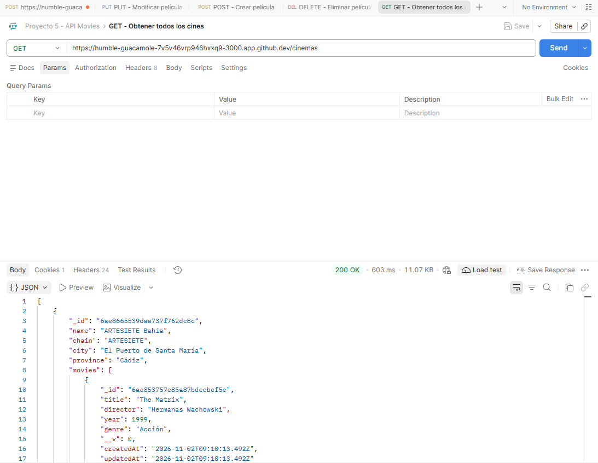
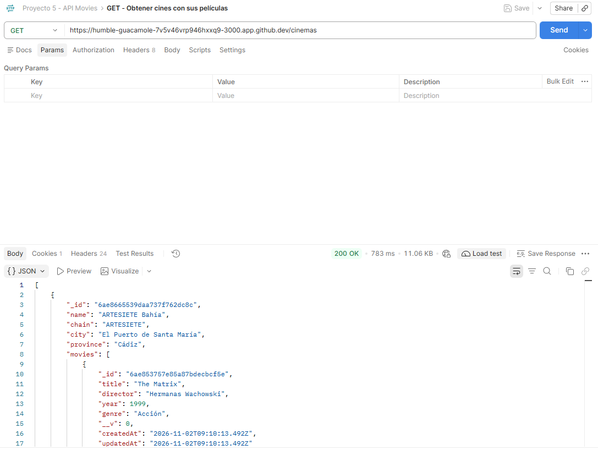
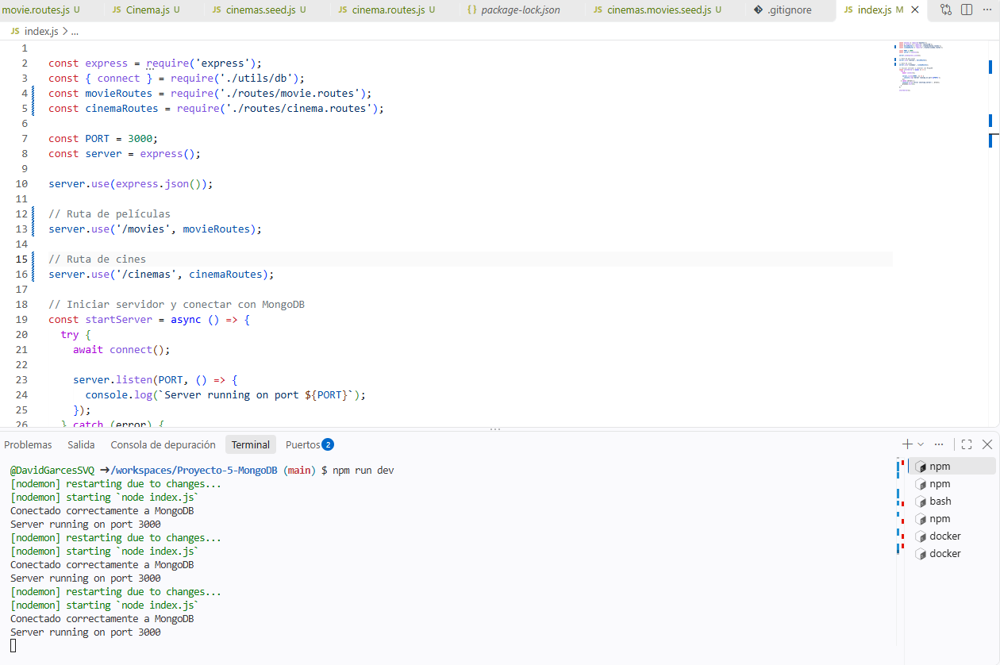

# Proyecto 5 - MongoDB

API REST desarrollada con Node.js, Express, MongoDB y Mongoose para gestionar una colección de películas y otra de cines.

## 1. Descripción del proyecto

El objetivo de este proyecto es trabajar con bases de datos NoSQL utilizando MongoDB y desarrollar una API REST que permita realizar operaciones de consulta, creación, modificación y eliminación de películas.

Además, se ha ampliado el proyecto con una colección de cines de la cadena ARTESIETE, relacionando cada cine con las películas que tiene asociadas.

## 2. Tecnologías utilizadas

- **Node.js:** entorno de ejecución de JavaScript.
- **Express:** framework para desarrollar la API REST.
- **MongoDB:** base de datos NoSQL.
- **Mongoose:** herramienta para definir modelos y gestionar las operaciones con MongoDB.
- **Docker:** utilizado para ejecutar MongoDB.
- **GitHub Codespaces:** entorno de desarrollo.
- **Postman:** herramienta utilizada para probar los endpoints de la API.

## 3. Organización del proyecto

La estructura principal del proyecto es la siguiente:

```text
Proyecto-5-MongoDB/
│
├── models/
│   ├── Movie.js
│   └── Cinema.js
│
├── routes/
│   ├── movie.routes.js
│   └── cinema.routes.js
│
├── utils/
│   └── db.js
│
├── movies.seed.js
├── cinemas.seed.js
├── cinemas.movies.seed.js
│
├── docker-compose.yml
├── index.js
├── package.json
├── package-lock.json
├── README.md
└── .gitignore
```

## 4. Base de datos y modelos

Se ha utilizado MongoDB con una base de datos denominada `proyecto-basico-express-movies`.

La aplicación trabaja con dos colecciones:

### 4.1. Colección Movies

Almacena la información de las películas mediante los siguientes campos:

- `title`: título de la película.
- `director`: director.
- `year`: año de estreno.
- `genre`: género cinematográfico.
- `createdAt` y `updatedAt`: fechas de creación y modificación.

Se han introducido películas de ejemplo para comprobar las diferentes operaciones de la API.

### 4.2. Colección Cinemas

Almacena información de los cines de la cadena ARTESIETE en España.

Los campos utilizados son:

- `name`: nombre del cine.
- `chain`: cadena a la que pertenece.
- `city`: ciudad.
- `province`: provincia.
- `address`: dirección del cine (campo opcional).
- `screens`: número de salas (campo opcional).
- `movies`: referencias a las películas asociadas al cine.
- `createdAt` y `updatedAt`: fechas de creación y modificación.

Se han introducido 11 cines de ejemplo, distribuidos entre Andalucía y el resto de España.

### 4.3. Relación entre películas y cines

Se ha establecido una relación entre las colecciones `cinemas` y `movies` mediante referencias a los identificadores de los documentos.

Para ello se ha utilizado `ObjectId` junto con `ref: 'Movie'` en el modelo Cinema.

También se ha utilizado el método `populate('movies')` para recuperar los datos completos de las películas asociadas a cada cine.

Se ha preparado una programación ficticia de ejemplo, asignando tres películas a cada cine para comprobar el funcionamiento de las relaciones.

## 5. Carga inicial de datos

Se han creado tres archivos para introducir los datos de ejemplo:

- `movies.seed.js`: elimina los documentos existentes de la colección de películas e introduce las seis películas iniciales.
- `cinemas.seed.js`: introduce los 11 cines de ARTESIETE.
- `cinemas.movies.seed.js`: establece las relaciones entre los cines y las películas existentes.

Estos archivos permiten preparar la base de datos antes de realizar las pruebas de la API.

## 6. API REST de películas

Las rutas de películas se encuentran en `routes/movie.routes.js`.

La API permite realizar las siguientes operaciones:

| Método | Endpoint | Descripción |
|---|---|---|
| GET | `/movies` | Obtener todas las películas |
| GET | `/movies/id/:id` | Buscar una película por su ID |
| GET | `/movies/title/:title` | Buscar películas por título |
| GET | `/movies/genre/:genre` | Buscar películas por género |
| GET | `/movies/year/:year` | Buscar películas por año |
| POST | `/movies` | Crear una película |
| PUT | `/movies/id/:id` | Modificar una película |
| DELETE | `/movies/id/:id` | Eliminar una película |

Se han incorporado validaciones y gestión de errores para controlar, entre otros casos, los identificadores incorrectos, los datos no válidos y las películas que no existen.

## 7. API REST de cines

Las rutas de consulta de cines se encuentran en `routes/cinema.routes.js`.

Se han implementado los siguientes endpoints:

| Método | Endpoint | Descripción |
|---|---|---|
| GET | `/cinemas` | Obtener todos los cines |
| GET | `/cinemas/id/:id` | Buscar un cine por su ID |
| GET | `/cinemas/city/:city` | Buscar cines por ciudad |
| GET | `/cinemas/province/:province` | Buscar cines por provincia |

Las consultas incluyen el método `populate('movies')`, permitiendo recuperar la información de las películas relacionadas con cada cine.

También se han incorporado bloques `try/catch` para gestionar posibles errores durante las consultas.

## 8. Instalación y ejecución

### 8.1. Instalar dependencias

Desde la terminal, ejecutar:

```bash
npm install
```

### 8.2. Iniciar MongoDB con Docker

```bash
docker compose up -d
```

### 8.3. Cargar los datos de ejemplo

Ejecutar los siguientes comandos:

```bash
node movies.seed.js
node cinemas.seed.js
node cinemas.movies.seed.js
```

Es importante mantener este orden para que las relaciones entre películas y cines puedan establecerse correctamente.

**Nota:** los archivos de semillas eliminan o sustituyen datos de sus respectivas colecciones. Deben utilizarse para preparar los datos de ejemplo, no para conservar modificaciones realizadas posteriormente.

### 8.4. Arrancar la API

```bash
npm run dev
```

La aplicación se ejecuta en el puerto 3000.

Al iniciar correctamente, se muestran los mensajes de conexión a MongoDB y de arranque del servidor.

## 9. Pruebas realizadas con Postman

Se han realizado pruebas con Postman para comprobar el funcionamiento de los endpoints.

### 9.1. Pruebas de películas

Se han probado las operaciones de consulta de películas, creación, modificación y eliminación.

Entre las comprobaciones realizadas se encuentran:

- Obtener todas las películas.
- Buscar una película por su identificador.
- Buscar por título.
- Filtrar por género.
- Filtrar por año de estreno.
- Crear una película mediante POST.
- Modificar una película mediante PUT.
- Eliminar una película mediante DELETE.
- Comprobar la respuesta cuando se busca una película eliminada.

### 9.2. Pruebas de cines

Se han probado las siguientes operaciones:

- Obtener todos los cines.
- Buscar un cine por su identificador.
- Buscar cines por ciudad.
- Buscar cines por provincia.
- Consultar los cines junto con las películas asociadas.

Las respuestas se han comprobado mediante los códigos HTTP y los datos JSON devueltos por la API.

### 9.3. Evidencias de las pruebas

Se incluyen las siguientes capturas de pantalla para documentar las pruebas realizadas con Postman y el funcionamiento de la aplicación.

### Pruebas de películas

**Consulta de todas las películas**



**Creación de una película (POST)**



**Modificación de una película (PUT)**



**Eliminación de una película (DELETE)**



### Pruebas de cines

**Consulta de todos los cines**



**Consulta de cines con sus películas asociadas**



### Arranque de la aplicación

**Conexión con MongoDB y arranque del servidor**



## 10. Adaptaciones respecto al enunciado original

Durante la implementación del proyecto se han realizado las siguientes adaptaciones:

1. **Conexión a MongoDB:** he utilizado Docker para ejecutar MongoDB en el entorno de GitHub Codespaces, evitando tener que instalar MongoDB directamente en el equipo. La conexión se realiza mediante `mongodb://localhost:27017/proyecto-basico-express-movies`.

2. **Conexión con Mongoose:** he omitido las opciones `useNewUrlParser` y `useUnifiedTopology`, ya que están obsoletas en las versiones actuales de Mongoose.

3. **Consulta por año:** he utilizado el operador `$gte` en lugar de `$gt` para incluir también las películas estrenadas en el año indicado. De esta manera, la consulta devuelve las películas estrenadas a partir de 2010 incluido, tal como solicita el enunciado.

4. **Carga inicial de datos:** el archivo `movies.seed.js` elimina los documentos existentes mediante `deleteMany({})` antes de insertar las seis películas de ejemplo, evitando duplicados al ejecutar nuevamente la semilla.

5. **Gestión de errores:** se han incorporado bloques `try/catch` en las operaciones de consulta y en la conexión con MongoDB para gestionar posibles errores.

6. **Ampliación de la base de datos:** se ha añadido una colección de cines de ARTESIETE con sus correspondientes modelos y rutas de consulta.

7. **Relación entre colecciones:** se han utilizado referencias `ObjectId` y el método `populate()` para relacionar las películas con los cines y recuperar sus datos.

## 11. Conclusión

La realización de este proyecto me ha permitido trabajar con MongoDB y Mongoose, comprender cómo se estructuran las bases de datos NoSQL y desarrollar una API REST utilizando Express.

He practicado las operaciones CRUD, la organización del código mediante modelos y rutas independientes, la gestión de errores y las consultas a diferentes colecciones.

Además, la ampliación con la colección de cines me ha permitido trabajar con referencias entre documentos y comprobar cómo recuperar información relacionada mediante `populate()`.

Las pruebas realizadas con Postman han permitido verificar el funcionamiento de los endpoints y comprobar las respuestas de la API.